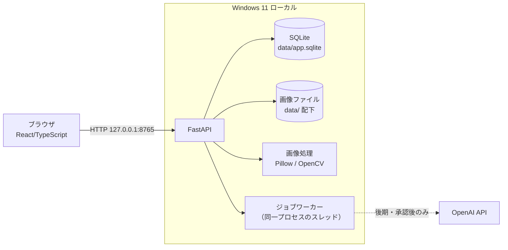

# 01 システム構成

状態: **設計案（承認待ち）** / 作成日: 2026-11-14

## 1. 方針
- Windows 11 のローカルで動く Web アプリ。ブラウザ（PC / iPad / iPhone）から操作する。
- 初期サーバーは `127.0.0.1` のみ待ち受け。LAN 公開は後期に認証付きで検討（0.8 以降）。
- GPU 不要（CPU 動作）。日本語パス対応。外部 API は初期無効。
- 実装は承認後。有料 API は呼ばない。

## 2. 全体図



## 3. 技術選定と理由
| 領域 | 採用案 | 理由 |
|---|---|---|
| フロント | React + TypeScript + Vite | 指示書の基本案。表編集・Canvas プレビューに向く |
| バックエンド | Python 3.12 + FastAPI + uvicorn | 画像処理ライブラリと同じ言語で完結 |
| DB | SQLite（標準 `sqlite3`） | 依存を増やさない。単一ファイルでバックアップ容易 |
| マイグレーション | 連番 SQL ファイル + `PRAGMA user_version` | Alembic/ORM を入れず最小構成（提案） |
| 画像 | Pillow（合成・書き出し）/ OpenCV（分割・マスク・背景除去補助） | 指示書の基本案 |
| 背景除去 | OpenCV（GrabCut／端からの塗りつぶし）+ 任意 rembg | rembg は重いので任意オプション（追加インストール） |
| 本番配信 | `npm run build` の成果物を FastAPI が静的配信 | 利用者は Node 不要・ポート1つ |
| 開発 | Vite dev(5173) → FastAPI(8765) へプロキシ | HMR で開発しやすい |

**変更提案（要承認）**: ORM（SQLAlchemy）は使わず素の SQL とする。テーブルは10前後で小さく、依存を減らせるため。

## 4. バックエンド構成（モジュール）
```
backend/app/
  main.py            起動・静的配信・127.0.0.1 バインド
  config.py          設定読込（環境変数 / data/settings）
  db.py              接続・マイグレーション適用
  api/               ルータ: characters, templates, projects, stamps,
                     assets, generation, processing, quality, exports,
                     history, settings, backup
  services/
    prompt_builder   参考写真+指示文をまとめコピー用に生成
    importer         画像取り込み（PNG/JPEG、D&D 複数）
    grid_splitter    4×3 分割・端数・境界調整
    alpha_tools      透過検査・背景除去補助・マスク適用
    text_renderer    日本語文字合成（フォント・色・縁・位置）
    quality_checker  機械検査（規格・欠損・越境・容量 等）
    exporter         並び替え・main/tab・ZIP・規格チェック
    backup           data/ の ZIP バックアップ
    jobs             ジョブ管理（後期 API 用、初期は枠のみ）
  util/paths.py      日本語パス・相対パス変換
```

## 5. 重要な設計判断
1. **非破壊編集**: 元画像は `originals/` に保持し、加工は「編集パラメータ（JSON）」として保存。Undo は履歴スタックの巻き戻し。ファイルを上書きしない。
2. **透過はチェッカー表示のみ**: チェッカー柄は CSS 描画。画像に焼き込まない（UI_DESIGN 準拠）。
3. **文字描画の一致**: 最終書き出しは Pillow。画面プレビューも同じ Pillow 描画結果を（デバウンスして）API から取得し、ドラッグ操作中のみ軽量な Canvas 仮表示を使う。これで「プレビューと出力の差」を防ぐ。
4. **日本語パス**: パスは `pathlib` で UTF-8 扱い。OpenCV の `imread/imwrite` は非 ASCII パスで失敗するため `numpy.fromfile + cv2.imdecode`（書き込みは `imencode + tofile`）を使う。DB には `data/` 起点の**相対パス**のみ保存。
5. **白い毛の保護**: 背景除去は自動結果を「提案マスク」として扱い、手動ブラシで修正してから確定。毛・白縁・文字を消さない確認をプレビューで強制（拡大表示 + 暗背景/チェッカー切替）。
6. **機械検査と目視承認を分離**: `qc_machine_status`（自動）と `approval_status`（人）を別カラムにし、機械検査 OK でも承認までは出力不可とする。
7. **ジョブ**: 初期は手動生成のため枠のみ。後期 API 連携時は DB 上のジョブ表 + 同一プロセスのワーカースレッドで、中断・再開・再試行・個別再生成・費用上限に対応。

## 6. セキュリティ・プライバシー
- 待ち受けは `127.0.0.1` 固定。CORS は `http://127.0.0.1:8765` と dev 時の `:5173` のみ許可。
- API キーは環境変数（`.env`、Git 除外）。ログ・API レスポンス・エラーに出さない（マスク処理）。
- 写真・DB・出力・バックアップ・フォント・`.env` は Git 除外（`.gitignore` 済み）。公開リポジトリに載せない。
- 外部 API へ写真を送る前に、画面で明示承認（0.7 以降）。
- 課金・外部公開・販売申請は常に承認が必要（自動実行しない）。
- 使用権確認（写真・フォント）をキャラクター/フォント登録時の必須チェックにする。

## 7. 非機能
- 日本語 UI。レスポンシブ（PC / iPad / iPhone）。タッチ・キーボード操作。
- 処理中・失敗・空状態・再試行を全画面で明示。
- 既存データを破壊しない（バックアップ → マイグレーション → 検証の順）。
- 性能目標（目安）: 12 分割 + プレビュー生成が一般的な PC で数秒以内。

## 8. 未確定事項（承認時に確認）
- LINE スタンプ規格は**実装前に公式ガイドラインで再確認**する（STAMP_RULES の数値は暫定）。
- rembg を初期から同梱するか、任意オプションにするか（提案: 任意）。
- ポート番号 8765 で問題ないか。
