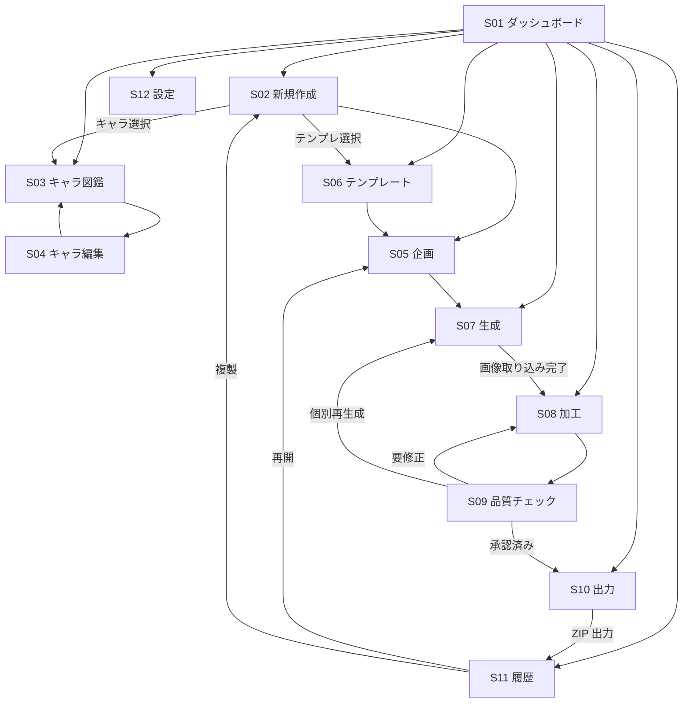

# 02 画面設計・画面遷移

状態: **設計案（承認待ち）** / 元仕様: UI_DESIGN.md, SPECIFICATION.md

## 1. 共通
- 日本語 UI。初期テーマは「ナチュラル」。後にレトロ・サイバーネオンを追加。テーマは CSS 変数で機能から独立させる。
- レイアウト: PC は左サイドナビ + メイン。iPad は折りたたみナビ。iPhone は下部タブ + 1 カラム。
- 全画面で「読み込み中 / 失敗（再試行ボタン）/ 空状態（次の操作案内）」を表示。
- 操作: キーボード（矢印・Delete・Ctrl+Z/Y）、タッチ（ピンチ拡大・ドラッグ）を考慮。

## 2. 画面一覧
| ID | 画面 | 主な内容 | 初出 |
|---|---|---|---|
| S01 | ダッシュボード | 新規作成 / 図鑑 / テンプレート / 生成 / 加工 / 出力 / 履歴 / 設定への入口、進捗と再開 | 0.1 |
| S02 | 新規作成 | キャラ・テーマ・個数(8/16/24/32/40)・画風・文字設定・生成方式 | 0.2 |
| S03 | キャラクター図鑑（一覧） | カード一覧、検索、使用権未確認の警告 | 0.1 |
| S04 | キャラクター編集 | 写真 D&D（複数）、犬種・毛色・耳・顔・体格・画風、使用権チェック、プレビュー | 0.1 |
| S05 | 企画（スタンプ表） | 番号・セリフ・ポーズ・表情・装飾・文字設定を表で編集、並び替え、感嘆符の警告 | 0.2 |
| S06 | テンプレート | 一覧、保存、複製、犬種差し替え、初期24テンプレート | 0.2 |
| S07 | 生成 | 12 個単位バッチ一覧、指示文コピー、画像取り込み、個別再生成、（後期）API・費用 | 0.3 |
| S08 | 加工 | グリッド分割、拡大、透過チェッカー、境界調整、文字・装飾・マスク編集、Undo | 0.4–0.5 |
| S09 | 品質チェック | 機械検査結果と目視承認（分離表示） | 0.6 |
| S10 | 出力 | 全スタンプ一覧、警告、main/tab 選択、日英タイトル・説明、ZIP、出力先 | 0.6 |
| S11 | 履歴 | プロジェクト検索、複製、生成履歴、進捗 | 0.2〜 |
| S12 | 設定 | 保存先、フォント（使用権チェック付き）、テーマ、バックアップ、API（初期無効） | 0.1〜 |

## 3. 画面遷移

## 4. 制作フロー（初期版・手動 ChatGPT 方式）
1. S03/S04 でキャラ登録（写真・使用権）
2. S02 で新規作成 → S05 で企画を編集
3. S07 で「参考写真 + 指示文」をまとめてコピー → ChatGPT で手動生成 → 生成画像を S07 に D&D で取り込み
4. S08 で 4×3 分割・境界調整・透過・文字後付け
5. S09 で機械検査 → 目視承認
6. S10 で並び替え・main/tab・タイトル説明 → ZIP 出力（販売申請は手動）

## 5. 主要画面の詳細

### S01 ダッシュボード
- 上部: 「新規作成」大ボタン。
- 中央: 進行中プロジェクト（進捗バー、「続きから」）。
- 下部: 各機能へのカード。
- 空状態: 「まずキャラクターを登録しましょう」。

### S04 キャラクター編集
- 左: 写真ドロップエリア（複数）と並び替え。右: 特徴フォーム。
- **使用権確認**チェックが未了だと保存はできるが「生成・外部送信」に進めない。
- 写真はローカル保存のみ。外部送信の注意文を常時表示。

### S05 企画（表）
- 列: 番号（自動）/ セリフ / ポーズ / 表情 / 装飾 / 文字設定 / 状態。
- 行のドラッグ並び替え、複数選択、一括置換、テンプレへ保存。
- セリフに「!」「！」が含まれると黄色警告（STAMP_RULES: 原則省略）。
- 個数変更時は不足行の追加/余剰行の確認。

### S07 生成
- 12 個単位のバッチカード（例: 24 個 = 2 バッチ、30 個なら 12+12+6 の端数バッチ）。
- 各バッチ: [指示文をコピー] [参考写真をまとめてコピー/保存] [画像を取り込む]。
- 「文字後付けモード」ON 時は「文字なしで生成」を指示文に自動付与。
- 個別再生成: セルごとに専用指示文を生成。
- （後期・初期は無効表示）API 実行: 費用見積もり → 上限設定 → 明示承認 → 実行/中断/再開/再試行。

### S08 加工
- 中央: 画像キャンバス（拡大縮小・パン）。右: パラメータパネル。下: セルサムネ列。
- 背景切替: チェッカー / 白 / 黒 / 色（表示のみ、画像は変更しない）。
- 分割: 初期は 4×3 の自動線、各境界を手動ドラッグ。端数バッチは行列数を指定。
- マスク: ブラシ（消す/戻す）、自動提案マスクの適用/破棄。白い毛の確認用に拡大ルーペ。
- 文字: フォント・サイズ・色・縁（太さ/色）・位置・折り返し。装飾スタンプ追加。
- Undo/Redo（Ctrl+Z / Ctrl+Y）、「元画像に戻す」。

### S09 品質チェック
- 機械検査（自動）: 文字一致（OCR は後期、初期は入力セリフとの目視比較補助）、欠損、セル越境、アルファ有無、サイズ、容量、余白、偶数サイズ。
- 目視承認（人）: キャラ統一、余分な手足、文字の読みやすさをスタンプ単位で ○/× 承認。
- 機械 OK でも未承認があれば出力不可。

### S10 出力
- 全スタンプグリッド、警告一覧、並び替え、main/tab の指定（トリミング付き）。
- 日英タイトル・説明文。規格チェック表（個数・サイズ・容量・命名）。
- ZIP 出力先選択（既定: `exports/`）。命名は `01.png`〜、`main.png`、`tab.png`。
- 「販売申請は LINE Creators Market で手動」の案内を表示。

### S12 設定
- 保存先、フォント登録（商用利用権チェック必須）、テーマ、バックアップ（手動実行・一覧・復元）。
- API: 初期は無効（トグル不可）。有効化時は環境変数のキー有無のみ表示（値は非表示）。

## 6. 状態パターン（共通）
| 状態 | 表示 |
|---|---|
| 読み込み中 | スケルトン + キャンセル可能な処理は中止ボタン |
| 失敗 | 原因（日本語）+ [再試行] + [ログの場所] |
| 空 | 説明 + 次の操作ボタン |
| 警告 | 黄色、出力は可能だが理由を明示 |
| エラー（規格違反） | 赤、出力ブロック |
