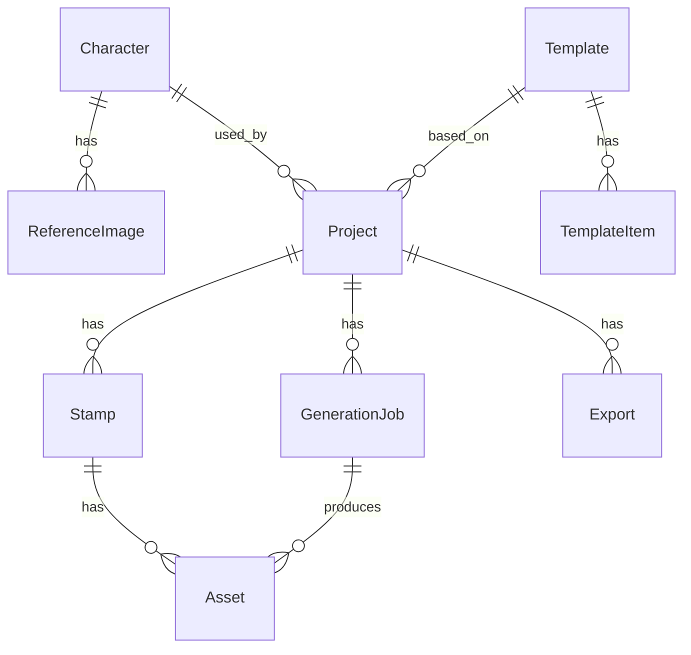

# 03 データベース設計

状態: **設計案（承認待ち）** / SQLite（`data/app.sqlite`）

## 1. 共通ルール
- 主キーは `id INTEGER PRIMARY KEY`。外部公開しないので連番で十分。
- 日時は ISO 8601（UTC）文字列 `created_at` / `updated_at`。
- ファイルパスは `data/` 起点の**相対パス**のみ保存（日本語可、区切りは `/`）。
- 状態値は文字列 + CHECK 制約。
- `PRAGMA foreign_keys=ON`、`journal_mode=WAL`。
- スキーマ版は `PRAGMA user_version`。`backend/migrations/0001_init.sql` のように連番 SQL を昇順適用。

## 2. ER 図

## 3. テーブル定義

### Character（キャラクター）
| 列 | 型 | 説明 |
|---|---|---|
| id | INTEGER PK | |
| name | TEXT NOT NULL | 表示名 |
| breed | TEXT | 犬種 |
| coat_color | TEXT | 毛色 |
| ears, face, body | TEXT | 耳・顔・体格の特徴 |
| art_style | TEXT | 画風 |
| rights_confirmed | INTEGER (0/1) | 写真の使用権確認 |
| rights_note | TEXT | 備考 |
| created_at, updated_at | TEXT | |

### ReferenceImage（参考写真）
id / character_id FK / rel_path / sort_order / note / created_at

### Template / TemplateItem
- Template: id / name / description / item_count / is_builtin / created_at / updated_at
- TemplateItem: id / template_id FK / sort_order / text / pose / expression / decoration / text_style_json

### Project（プロジェクト）
| 列 | 説明 |
|---|---|
| id, title, title_en, description, description_en | |
| character_id FK, template_id FK(NULL可) | |
| theme, art_style | |
| stamp_count | 8/16/24/32/40（CHECK） |
| gen_mode | `manual` / `api` |
| text_mode | `baked`（生成時に文字）/ `overlay`（後付け） |
| status | `draft` / `generating` / `processing` / `review` / `ready` / `exported` |
| main_stamp_id, tab_stamp_id | FK(NULL可) |
| settings_json | 文字設定の既定など |
| created_at, updated_at | |

### Stamp（スタンプ 1 個）
| 列 | 説明 |
|---|---|
| id, project_id FK, sort_order | 並び順（出力連番の元） |
| text, pose, expression, decoration | 企画内容 |
| text_style_json | フォント・色・サイズ・縁・位置 |
| edit_params_json | 非破壊編集パラメータ（分割枠、マスク参照、装飾） |
| edit_history_json | Undo 用履歴（上限件数あり） |
| qc_machine_status | `unchecked` / `ok` / `warn` / `error` |
| qc_machine_report_json | 検査結果の詳細 |
| approval_status | `pending` / `approved` / `rejected` |
| approved_at | |
| created_at, updated_at | |

### Asset（画像ファイル）
| 列 | 説明 |
|---|---|
| id, project_id FK, stamp_id FK(NULL可), job_id FK(NULL可) | |
| kind | `source_sheet`（生成シート）/ `cell`（分割後）/ `mask` / `processed` / `final` / `main` / `tab` |
| rel_path | 相対パス |
| width, height, bytes, has_alpha, sha256 | |
| is_original | 元画像フラグ（上書き禁止） |
| created_at | |

### GenerationJob（生成ジョブ）
| 列 | 説明 |
|---|---|
| id, project_id FK | |
| batch_index, cell_range | 12 個単位のバッチ番号と範囲（端数対応） |
| method | `manual` / `api` |
| status | `pending` / `copied` / `imported` / `running` / `paused` / `failed` / `done` / `canceled` |
| prompt_text | 生成指示文 |
| attempt_count, last_error | 再試行情報 |
| estimated_cost, actual_cost, cost_limit | 後期 API 用（初期 NULL） |
| created_at, updated_at | |

### Export（出力履歴）
id / project_id FK / zip_rel_path or 出力先絶対パス / stamp_count / report_json（規格チェック結果）/ created_at

### Settings
key TEXT PK / value_json TEXT / updated_at。例: `output_dir`, `theme`, `font_list`, `api_enabled`(初期 false)。

## 4. インデックス
`Stamp(project_id, sort_order)`、`Asset(project_id, kind)`、`Asset(stamp_id)`、`GenerationJob(project_id, batch_index)`、`Project(status, updated_at)`。

## 5. 移行・バックアップ
1. 起動時に `user_version` を確認し、未適用のマイグレーションがあれば**先に `data/` 全体を自動バックアップ**してから適用。
2. 失敗時は適用前バックアップから復元できるよう手順をログに案内（既存データを壊さない）。
3. `backup.bat`: `data/`（DB + 画像）を日時付き ZIP で `backups/` に保存。DB は `sqlite3 .backup` API で整合性を保って取得。
4. 世代管理: 既定で直近 10 件を保持（設定可）。削除は確認付き。

## 6. 保存しないもの
API キー（環境変数のみ）、個人情報の外部コピー、フォントファイル本体を Git に入れない（`fonts/` は Git 除外）。
